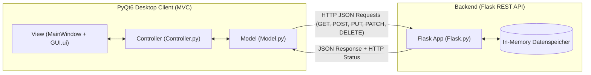

# 🚌 Wiener Verkehrsbetriebe – Mitarbeiter Management (REST API & Desktop Client)

Ein vollständiges Client-Server-System zur Verwaltung und Analyse monatlicher Mitarbeiterzahlen verschiedener Verkehrsmittel (Bus, Straßenbahn, U-Bahn) der Wiener Verkehrsbetriebe. Entwickelt im Rahmen des Gegenstands **Softwareentwicklung (SEW)** an der HTL TGM Wien (5. Jahrgang, 2. Semester).

Das Projekt implementiert:
1. Ein **RESTful Web Service Backend** auf Basis von **Flask** mit vollständigen CRUD-Endpunkten und Eingabevalidierung.
2. Einen **Desktop GUI-Client** auf Basis von **PyQt6**, strukturiert nach dem **Model-View-Controller (MVC)** Pattern.

---

## 📋 Inhaltsverzeichnis

- [Architektur](#-architektur)
- [Funktionsumfang](#-funktionsumfang)
- [REST API Dokumentation](#-rest-api-dokumentation)
- [GUI Client Features](#-gui-client-features)
- [Projektstruktur](#-projektstruktur)
- [Installation & Setup](#-installation--setup)
- [Ausführung](#-ausführung)
- [Automatisierte Tests](#-automatisierte-tests)
- [Autor](#-autor)

---

## 🏛 Architektur

Das Projekt folgt einer sauberen Trennung zwischen Server- und Client-Logik:



- **Model (`Model.py`)**: Übernimmt die Netzwerkkommunikation (`requests`), Fehlerbehandlung (Timeouts, Verbindungsabbrüche, HTTP-Fehlercodes) und Aufbereitung der Rohdaten in formatiertes HTML für die Anzeige.
- **View (`MainWindow.py` & `GUI.ui`)**: Verantwortlich für die Benutzeroberfläche, basierend auf Qt Designer. Enthält Tabs für Einzelabfragen und ein Admin-Dashboard.
- **Controller (`Controller.py`)**: Verbindet UI-Events (Button-Clicks, Dropdown-Auswahl) mit den Logik-Methoden des Models und aktualisiert die View.
- **Backend (`Flask.py`)**: Stateless HTTP REST-Service mit In-Memory Datenspeicher für `bus`, `tram` und `ubahn`.

---

## ✨ Funktionsumfang

- **Vollständige CRUD-Operationen**:
  - `GET`: Abruf einzelner Monate oder vollständiger Jahresansichten.
  - `POST`: Neuanlage eines bisher nicht erfassten Monats.
  - `PUT`: Überschreiben der Mitarbeiteranzahl eines Monats.
  - `PATCH`: Inkrementelle / dekrementelle Anpassung (Delta) der Mitarbeiteranzahl.
  - `DELETE`: Entfernen des Eintrags eines Monats.
- **Umfassende Validierung**:
  - Überprüfung gültiger Monatsbereiche (1–12).
  - Plausibilitätsprüfungen der Mitarbeiteranzahl (z. B. 0–250 bei Neuanlage, Delta bei Patch).
  - Rückgabe standardisierter HTTP-Statuscodes (`200 OK`, `201 Created`, `400 Bad Request`, `404 Not Found`, `409 Conflict`).
- **Moderne PyQt6 Benutzeroberfläche**:
  - **Tab 1 (Abfrage)**: Abfrage von Daten für ein bestimmtes Verkehrsmittel (Einzelmonat oder Jahresübersicht) mit HTML-formatierter Anzeige.
  - **Tab 2 (Admin-Dashboard)**: Multi-Panel-Ansicht für alle drei Verkehrsmittel gleichzeitig, intuitive Steuerung aller HTTP-Methoden und dynamische Statusbar-Benachrichtigungen.
- **Ausfallsicherheit**: Client-seitige Abfangung von Netzwerkfehlern, Timeouts und Server-Down-Szenarien ohne Programmabsturz.

---

## 🌐 REST API Dokumentation

Der Server läuft standardmäßig auf `http://127.0.0.1:5000`.

### Endpunkte im Überblick

| Methode | Pfad | Beschreibung | Statuscodes |
| :--- | :--- | :--- | :--- |
| `GET` | `/` | API-Guide und Dokumentation der Endpunkte | `200` |
| `GET` | `/verkehr/<verkehrsmittel>` | Jahresübersicht aller Monate für ein Verkehrsmittel (`bus`, `tram`, `ubahn`) | `200`, `404` |
| `POST` | `/verkehr/<verkehrsmittel>` | Neuen Monatswert anlegen (0–250 Beschäftigte) | `201`, `400`, `404`, `409` |
| `PUT` | `/verkehr/<verkehrsmittel>/` | Mitarbeiteranzahl eines Monats überschreiben | `200`, `400`, `404` |
| `PATCH` | `/verkehr/<verkehrsmittel>` | Mitarbeiteranzahl um ein Delta anpassen (-250 bis +250) | `200`, `400`, `404` |
| `DELETE` | `/verkehr/<verkehrsmittel>` | Monatswert eines Verkehrsmittels entfernen | `200`, `400`, `404` |

### Beispiel-Requests (cURL)

**Jahresansicht abrufen:**
```bash
curl -X GET http://127.0.0.1:5000/verkehr/bus
```

**Neuen Eintrag anlegen (POST):**
```bash
curl -X POST http://127.0.0.1:5000/verkehr/bus \
     -H "Content-Type: application/json" \
     -d '{"monat": 12, "Mitarbeiteranzahl": 60}'
```

**Mitarbeiteranzahl anpassen (PATCH Delta):**
```bash
curl -X PATCH http://127.0.0.1:5000/verkehr/tram \
     -H "Content-Type: application/json" \
     -d '{"monat": 5, "Mitarbeiteranzahl": 15}'
```

**Eintrag löschen (DELETE):**
```bash
curl -X DELETE http://127.0.0.1:5000/verkehr/ubahn \
     -H "Content-Type: application/json" \
     -d '{"monat": 11}'
```

---

## 🖥 GUI Client Features

Die PyQt6 Desktop-Anwendung bietet:

1. **Tab 1 – Datenabfrage**:
   - Auswahl des Verkehrsmittels über Dropdown (`bus`, `ubahn`, `tram`).
   - Auswahl des gewünschten Monats via SpinBox (1–12).
   - CheckBox zur Aktivierung der Gesamt-Jahresansicht.
   - Textausgabe formatiert mit Monatsnamen (Jänner bis Dezember) und Mitarbeiteranzahl.
2. **Tab 2 – Admin / CRUD Interface**:
   - Dropdown zur Auswahl der HTTP-Aktion (`Jahresansicht`, `PUT`, `PATCH`, `POST`, `DELETE`).
   - Parallele Anzeige von **Bus**, **Straßenbahn** und **U-Bahn** in drei separaten Browser-Panels.
   - Dynamische Rückmeldung über Status- und Fehlercodes in der Qt-Statusleiste.
   - Reset-Funktion zum Zurücksetzen aller Eingaben.

---

## 📁 Projektstruktur

```
restful-webservice-TimonHollaus/
├── README.md               # Projektdokumentation
└── thollaus/               # Quellcode
    ├── main.py             # Einstiegspunkt für die GUI-Anwendung
    ├── Flask.py            # RESTful API Backend (Flask Server)
    ├── Model.py            # MVC-Model: HTTP-Anfragen & Formatierung (+ Unit-Tests)
    ├── MainWindow.py       # MVC-View: Fensterlogik & UI-Bindings
    ├── Controller.py       # MVC-Controller: Event-Handling & Steuerung
    └── GUI.ui              # Qt Designer XML-Layout
```

---

## 🚀 Installation & Setup

### Voraussetzungen
- Python 3.10 oder neuer
- Git

### 1. Repository klonen
```bash
git clone https://github.com/TimonHollaus/restful-webservice-TimonHollaus.git
cd restful-webservice-TimonHollaus
```

### 2. Virtuelle Umgebung erstellen (empfohlen)
```bash
python -m venv venv
# Unter Windows:
.\venv\Scripts\activate
# Unter Linux/macOS:
source venv/bin/activate
```

### 3. Abhängigkeiten installieren
```bash
pip install Flask Flask-Cors PyQt6 requests
```

---

## ⚙️ Ausführung

Das System besteht aus Backend und Client, die in separaten Terminals gestartet werden:

### Schritt 1: Backend starten
```bash
python thollaus/Flask.py
```
> Der Server startet unter `http://127.0.0.1:5000` im Debug-Modus.

### Schritt 2: GUI-Client starten
In einem neuen Terminal (mit aktivierter Umgebung):
```bash
python thollaus/main.py
```

---

## 🧪 Automatisierte Tests

In `Model.py` sind Modultests integriert, welche die Datenverarbeitung, Fehlerabfangung und Formatierung prüfen:

```bash
python thollaus/Model.py
```

Die Tests validieren:
- Rückgabetypen bekannter und unbekannter Endpunkte
- Validierung bei nicht laufendem Server (Graceful Error Handling)
- HTML-Formatierungslogik für Einzel- und Jahresansichten

---

## 👤 Autor

**Timon Hollaus**  
Schulprojekt an der HTL TGM Wien (Abteilung Informationstechnologie)
